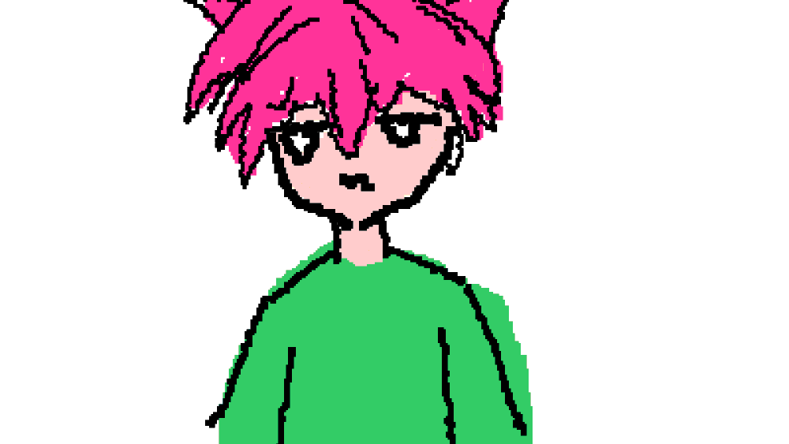

# 🎨 Moe Wiggly Studio

¡Ey, gente! 👋

Os presento **Moe Wiggly Studio**, mi propia aplicación de dibujo en movimiento. He intentado crear algo bastante completo, con un montón de opciones para dibujar, experimentar y, sobre todo, pasar un buen rato haciendo que los trazos cobren vida.

Os hago un pequeño recorrido por lo que podéis encontrar, pero os recomiendo de verdad que entréis, lo probéis y trasteéis un poco. ¡Seguro que descubrís combinaciones que ni yo me esperaba! 😄

## ¡Hola! Soy Jimi 👋

**Esta es mi creación.** ✨

  

## ✨ Y ahora... ¡con movimiento, cobro vida!

  

## 🖌️ Aquí los trazos no se quedan quietos

Podéis usar distintos pinceles y estilos: desde lápices y rotuladores hasta tinta, neón, tiza, estrellas, puntos y efectos de píxeles. Pero la gracia no acaba ahí. También hay diferentes maneras de darle movimiento a lo que dibujáis, con efectos ondulados, líquidos, nerviosos, elásticos, caóticos y algún que otro glitch. Vamos, que podéis hacer una línea normalita… o conseguir que parezca que está teniendo un día complicado.

Podéis cambiar el tamaño y el color del pincel, borrar, rellenar zonas, coger colores directamente del dibujo y jugar con las herramientas para encontrar vuestro propio estilo. Aquí se viene a experimentar. Si sale una obra maestra, genial; si sale un garabato rarísimo, también cuenta. 😎

## 🎨 El lienzo es vuestro

Elegid los colores, cambiad el fondo y ajustad el lienzo a vuestra idea. Acercaos para trabajar en los detalles, alejaos para ver el dibujo entero y moved la vista para no perderos por el camino. La idea es que tengáis espacio para probar cosas sin pelearos con la herramienta.

## 🧩 ¿La he liado? No pasa nada

Podéis trabajar con capas para tener el dibujo más organizado, controlar qué se ve y ajustar la opacidad. Y, por supuesto, están las opciones de deshacer y rehacer, porque todos sabemos que a veces ese trazo que parecía una idea brillante hace dos segundos ya no nos convence tanto.

## 💾 Que no se pierdan las obras de arte

La aplicación guarda el trabajo en el navegador y os permite gestionar vuestros proyectos. También podéis exportar e importar proyectos para volver a abrirlos y seguir trabajando más adelante. Eso sí, como el guardado local depende del navegador y del dispositivo, os recomiendo guardar una copia de los proyectos importantes. Más vale prevenir que tener que recrear aquella línea perfecta que salió por accidente.

## 🎞️ Un dibujo está bien, ¡pero también puede moverse!

Podéis guardar vuestras creaciones como imágenes PNG, incluso con fondo transparente, o convertirlas en GIF animados. También hay exportación de vídeo, con opciones para ajustar la duración, los fotogramas por segundo, la calidad y la resolución. Incluso podéis usar fondos de color pensados para croma, por si queréis darle otro uso al resultado.

Las exportaciones más exigentes dependen de la potencia del dispositivo y del navegador, así que si intentáis sacar un vídeo enorme y vuestro ordenador empieza a pensar en sus decisiones vitales, probad con una resolución más baja. 😂

## 🤝 ¿Y si dibujamos juntos?

También hay un modo online para compartir una sala y dibujar con otras personas. Podéis ver los trazos y los cursores de los demás mientras trabajáis, así que ya no hay excusa para discutir quién ha dibujado esa cosa extraña que acaba de aparecer en el lienzo.

## 📱 Probadla a vuestra manera

La interfaz se adapta a distintos tamaños de pantalla y podéis dibujar con ratón o con pantalla táctil en los dispositivos compatibles. Hay bastantes efectos visuales, pero si notáis que vuestro dispositivo va un poco ahogado, podéis desactivar **Liquid Glass** desde los ajustes.

## ❤️ Ahora os toca a vosotros

He dedicado tiempo a intentar que esto sea algo más que un lienzo en blanco, y me hace ilusión que lo probéis. Curiosead, mezclad pinceles, dibujad cualquier cosa y exportad vuestras creaciones. No hace falta saber dibujar bien para divertirse con ello; de hecho, a veces los resultados más graciosos salen cuando uno no tiene ni idea de lo que está haciendo.

Si encontráis algún error o se os ocurre una mejora, contádmelo en el apartado de Issues del repositorio. Me encantará saber qué os parece y qué os gustaría ver en el futuro.

**¡Gracias por pasaros por Moe Wiggly Studio! Ahora id a dibujar algo raro y enseñadme de qué sois capaces.** 🖤
